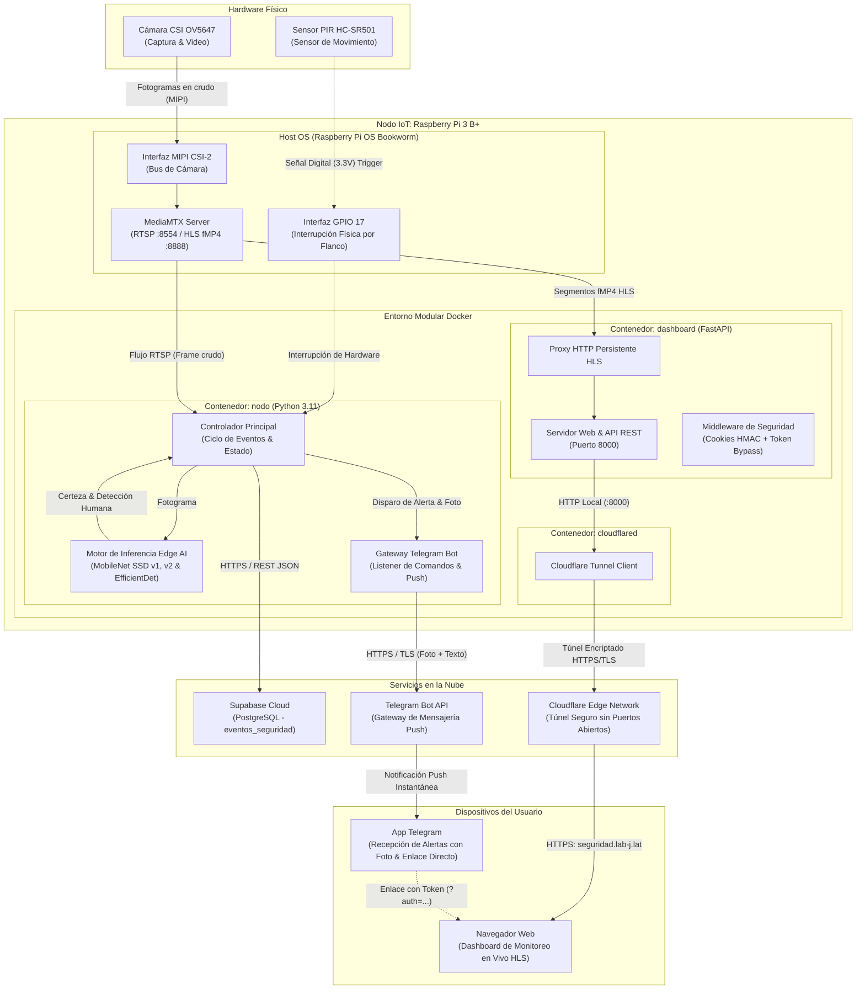

# Sistema de Seguridad Inteligente con Edge AI y Cloudflare Tunnels

> **Pontificia Universidad Javeriana**  
> **Departamento de Ingeniería Electrónica**  
> **Sistemas Embebidos**  
>  
> **Integrantes:**  
> • Andrés Felipe Jiménez Albor (`andresf.jimeneza@javeriana.edu.co`)  
> • Daniel Santiago Caicedo Guzmán (`caicedo-ds@javeriana.edu.co`)  

---

## 1. Descripción del Proyecto

Los sistemas de videovigilancia convencionales enfrentan dos problemas críticos:
1. **Falsos positivos continuos:** Dispositivos basados únicamente en hardware PIR o detección elemental de píxeles disparan alertas innecesarias ante mascotas, sombras, cambios de luz o viento, saturando al usuario de notificaciones espurias.
2. **Dependencia y sobrecarga a la nube:** Las cámaras comerciales transmiten video continuo 24/7 a servidores externos, consumiendo un ancho de banda masivo y vulnerando la privacidad en entornos residenciales o institucionales.

### Solución Propuesta: Distribución Inteligente del Trabajo
Este proyecto implementa una arquitectura híbrida de **procesamiento distribuido** sobre una **Raspberry Pi 3 B+**, ejecutando cuatro etapas secuenciales:

```
[Sensor PIR] ──(Interrupción)──▶ [Cámara CSI] ──(Fotograma)──▶ [Edge AI TFLite]
                                                                      │
                       ┌──────────────────────────────────────────────┴──────────────────────────────┐
                       ▼ (Si confirma "Persona")                                                     ▼ (Falso Positivo)
             [Alertas Push Telegram]                                                               [Descarte / Dormir]
             [Registro Cloud Supabase]
             [Streaming Bajo Demanda Cloudflare]
```

1. **Detección Eficiente en Reposo:** La Raspberry Pi permanece en estado de bajo consumo. Solo cuando el sensor PIR detecta actividad física, genera una interrupción de hardware que "despierta" la cámara para capturar la evidencia.
2. **Filtrado con Edge AI:** En lugar de saturar la red, la imagen capturada es evaluada localmente en la RPi mediante **tres modelos cuantizados de TensorFlow Lite** (INT8). Si el consenso confirma presencia humana, detona la alerta; si fue una perturbación ambiental, se descarta en el acto sin salir a internet.
3. **Registro y Notificación Inmediata:** Si la intrusión es verídica, se envía una notificación push instantánea al usuario por **Telegram** con la fotografía, el porcentaje de certeza y el consenso de modelos, registrando simultáneamente los metadatos en **Supabase Cloud (PostgreSQL)**.
4. **Streaming de Video Bajo Demanda y Seguro:** El video en vivo solo se transmite cuando el usuario lo solicita a través de un **Dashboard Web seguro**, protegido con autenticación por clave y token, y expuesto a internet mediante un **Túnel de Cloudflare** sin abrir puertos en el router.

---

## 2. Arquitectura del Sistema (Hardware, Software y Protocolos)

A continuación se presenta la arquitectura integral basada en la propuesta técnica del proyecto:



### Tabla de Protocolos y Comunicación

| Enlace / Interfaz                      | Tipo de Conexión                | Protocolo / Formato             | Propósito                                             |
| -------------------------------------- | ------------------------------- | ------------------------------- | ----------------------------------------------------- |
| **PIR $\rightarrow$ RPi**              | Conexión física                 | Lógica digital (3.3V)           | Interrupción por hardware en GPIO 17                  |
| **Cámara $\rightarrow$ RPi**           | Cinta plana MIPI CSI-2          | Raw video CSI                   | Captura de video en tiempo real sin recargar la CPU   |
| **Cámara $\rightarrow$ MediaMTX**      | Interno V4L2 / libcamera        | RTSP (`:8554`) / HLS (`:8888`)  | Servidor de streaming bajo demanda con GOP = 1s       |
| **MediaMTX $\rightarrow$ Nodo**        | Socket TCP interno              | RTSP / OpenCV                   | Extracción de fotogramas congelados ante eventos PIR  |
| **MediaMTX $\rightarrow$ Dashboard**   | HTTP keep-alive persistent pool | HLS fMP4 (fragmentos 1s)        | Proxy seguro de video para navegadores modernos       |
| **Nodo $\rightarrow$ Supabase**        | WAN segura                      | HTTPS REST (`/rest/v1`) / JSON  | Persistencia en la nube de eventos y certeza IA       |
| **Nodo $\rightarrow$ Telegram**        | WAN segura                      | HTTPS REST (`api.telegram.org`) | Envío de fotos y recepción de comandos del bot        |
| **Dashboard $\rightarrow$ Cloudflare** | WAN segura                      | Túnel TLS encriptado            | Exposición a internet sin apertura de puertos NAT/WAN |

---

## 3. Especificaciones de Hardware y Conexiones GPIO

### 3.1 Hardware Utilizado

1. **Raspberry Pi 3 Modelo B+:**
   - SoC Broadcom BCM2837B0, quad-core Cortex-A53 a 1.4 GHz.
   - 1 GB de memoria SDRAM LPDDR2.
   - Conectividad Wi-Fi dual-band (2.4 GHz y 5 GHz) 802.11ac y Bluetooth 4.2.
   - Conector CSI para módulo de cámara.
   - Cabezal GPIO de 40 pines.
2. **Sensor de Movimiento Infrarrojo Pasivo (PIR HC-SR501):**
   - Alimentación: 5V DC.
   - Salida lógica: 3.3V TTL (compatible nativamente con la Raspberry Pi sin divisor resistivo).
   - Ángulo de cono: 110°.
   - Rango de detección: hasta 7 metros.
   - Modo de disparo: Jumper en **H** (re-disparo continuo) y potenciómetro de tiempo de retardo al mínimo.
3. **Módulo de Cámara Raspberry Pi (CSI):**
   - Sensor Omnivision OV5647 de 5 MP.
   - Conexión por bus MIPI CSI-2 dedicado.
   - Soporte de captura y video 720p a 20/30 FPS con codificación por hardware H.264.

### 3.2 Diagrama de Conexiones GPIO (Header J8)

| Pin Físico RPi | Nombre del Pin |     Dispositivo Externo     | Cable  | Función                                              |
| :------------: | :------------: | :-------------------------: | :----: | :--------------------------------------------------- |
|   **Pin 02**   |       5V       | Sensor PIR HC-SR501 (`VCC`) |  Azul  | Alimentación de 5V DC                                |
|   **Pin 06**   |     Ground     | Sensor PIR HC-SR501 (`GND`) | Morado | Masa / Referencia común                              |
|   **Pin 11**   |    GPIO 17     | Sensor PIR HC-SR501 (`OUT`) | Blanco | Señal de disparo digital (Interrupción por hardware) |
|  **Slot CSI**  |   MIPI CSI-2   |      Cámara CSI OV5647      | Cinta  | Bus de video serial de alta velocidad                |

---

## 4. Especificaciones de Software y Edge AI

### 4.1 Motores de Inferencia Embebidos (TensorFlow Lite INT8)
Para validar la presencia humana y eliminar falsos positivos sin dependencia de servidores externos, el nodo ejecuta tres modelos optimizados en formato cuantizado INT8:

| Modelo | Arquitectura | Cuantización | Tiempo de Inferencia (RPi 3B+) | Propósito |
|---|---|:---:|:---:|---|
| **MobileNet SSD v1** | MobileNetV1 + SSD | INT8 | **~150 ms** | Detección primaria ultra-rápida |
| **MobileNet SSD v2** | MobileNetV2 + SSD | INT8 | **~165 ms** | Modelo de confirmación COCO |
| **EfficientDet-Lite0** | BiFPN + Compound Scaling | INT8 | **~270 ms** | Validación de alta precisión espacial |

El sistema implementa una **lógica de consenso**: una intrusión se clasifica como verdadera cuando al menos dos de los tres modelos detectan una persona con certeza superior al umbral configurado ($> 50\%$), reportando el promedio de confianza obtenido.

### 4.2 Dashboard Web y Seguridad
Desarrollado en **FastAPI** con frontend en **Tailwind CSS**, incluye:
- **Distribución:**
  - **Columna Izquierda:** Reproductor de video HLS fMP4 en tiempo real con reloj OSD y buffer sintonizado a 3.0s de retardo constante para máxima fluidez sin cortes.
  - **Columna Derecha:** Panel lateral con pestañas unificadas:
    - **Pestaña `INCIDENTES`:** Lista en tiempo real de eventos con % de certeza, hora exacta, modelos confirmados y visor modal.
    - **Pestaña `CAPTURAS`:** Cuadrícula compacta de miniaturas fotográficas locales.
- **Capa Integral de Autenticación:**
  - Protección de todas las rutas y APIs con cookies de sesión firmadas con HMAC (`seguridad_session`, duración de 7 días).
  - Acceso directo tokenizado (`?auth=TOKEN_SECRETO`) integrado en los mensajes de Telegram para apertura con un solo toque desde el smartphone.

---

## 5. Estructura del Repositorio

```text
.
├── docker-compose.yml              # Orquestación de contenedores (nodo, dashboard, cloudflared)
├── .env.example                    # Plantilla de variables de entorno seguras
├── .gitignore                      # Reglas de exclusión para git (secretos, capturas, logs)
├── README.md                       # Documentación técnica completa
├── verdad.csv                      # Conjunto de validación para evaluación offline
│
├── nodo/                           # Microservicio de Edge AI y Control
│   ├── Dockerfile                  # Contenedor Python 3.11 con acceso a GPIO y libcamera
│   ├── requirements.txt            # tflite-runtime, opencv, httpx, gpiozero
│   ├── main.py                     # Bucle principal de interrupciones y Telegram listener
│   ├── detector.py                 # Inferencia paralela con los 3 modelos TFLite
│   ├── camara.py                   # Extractor de fotogramas RTSP y rotación de microSD
│   ├── registro.py                 # Persistencia dual (Supabase Cloud + CSV local de respaldo)
│   ├── telegram_bot.py             # Cliente de Telegram (envío de fotos y parseo de comandos)
│   └── config.py                   # Variables de entorno y rutas del sistema
│
├── dashboard/                      # Microservicio Web y Streaming
│   ├── Dockerfile                  # Contenedor FastAPI optimizado
│   ├── requirements.txt            # fastapi, uvicorn, jinja2, httpx
│   ├── app.py                      # Backend API, middleware de auth y proxy HLS keep-alive
│   └── templates/
│       ├── index.html              # Interfaz moderna con pestañas y reproductor HLS
│       └── login.html              # Pantalla de acceso seguro
│
├── mediamtx/                       # Servidor de Streaming Multimedia
│   └── mediamtx.yml                # Configuración de cámara CSI, 720p, GOP=1s y HLS fMP4
│
├── modelos/                        # Modelos de Inteligencia Artificial cuantizados
│   ├── detect.tflite               # MobileNet SSD v1 (Quant INT8)
│   ├── efficientdet_lite0.tflite   # EfficientDet-Lite0 (Quant INT8)
│   ├── ssd_mobilenet_v2_coco_quant_postprocess.tflite
│   └── labelmap.txt                # Etiquetas COCO (filtrado de ID 0: 'person')
│
├── supabase/                       # Esquemas y Scripts de Base de Datos
│   └── schema.sql                  # Definición DDL de la tabla 'eventos_seguridad' e índices
│
├── imagenes_prueba/                # Imágenes de prueba para benchmark local
│
└── scripts/                        # Utilidades operativas y diagnóstico
    ├── descargar_modelos.sh        # Descarga automatizada de pesos TFLite
    ├── comparar_carpeta.py         # Script de evaluación de exactitud y falsos positivos
    ├── monitorear_recursos.sh      # Monitor en tiempo real de CPU, RAM y temperatura
    └── verificar.sh                # Test de conectividad de periféricos y contenedores
```

---

## 6. Despliegue y Puesta en Marcha

### 6.1 Requisitos
1. Interfaz de cámara habilitada en `raspi-config`.
2. Docker y Docker Compose instalados:
   ```bash
   curl -fsSL https://get.docker.com | sh
   sudo usermod -aG docker $USER
   ```
3. Binario de **MediaMTX** configurado como servicio en el host para acceso directo al hardware de cámara CSI:
   ```bash
   sudo systemctl enable --now mediamtx
   ```

### 6.2 Configuración del Archivo `.env`
Copia la plantilla y configura tus credenciales:
```bash
cp .env.example .env
nano .env
```
Valores obligatorios:
- `CLOUDFLARE_TUNNEL_TOKEN`: Token de tu túnel en Cloudflare Zero Trust.
- `DASHBOARD_PUBLIC_URL`: URL pública asignada (ej. `https://seguridad.lab-j.lat`).
- `DASHBOARD_PASSWORD`: Contraseña para el inicio de sesión web.
- `DASHBOARD_TOKEN`: Clave secreta para el bypass de un toque en Telegram.
- `TELEGRAM_TOKEN`: Token del bot generado por `@BotFather`.
- `TELEGRAM_CHAT_ID`: ID del grupo o chat de recepción (ej. `-5301688862`).
- `SUPABASE_URL` y `SUPABASE_KEY`: Credenciales de tu proyecto en Supabase.

### 6.3 Inicialización de la Base de Datos
En la consola de Supabase, ejecuta el contenido de [`supabase/schema.sql`](supabase/schema.sql) para crear la tabla de auditoría:
```sql
CREATE TABLE IF NOT EXISTS public.eventos_seguridad (
    id BIGSERIAL PRIMARY KEY,
    created_at TIMESTAMPTZ DEFAULT NOW(),
    confianza_ia DOUBLE PRECISION NOT NULL,
    modelos_positivos INT DEFAULT 1,
    modelos_totales INT DEFAULT 3,
    estado_alerta TEXT DEFAULT 'alerta_confirmada',
    imagen TEXT,
    metadatos JSONB DEFAULT '{}'::jsonb
);
```

### 6.4 Inicio de los Servicios con Docker
Para arrancar todo el sistema modular:
```bash
# Construir e iniciar contenedores en segundo plano
docker compose up -d --build

# Verificar estado de los servicios
docker compose ps
```

---

## 7. Comandos Interactivos del Bot de Telegram

El bot integrado (`@Celachoobot`) permite supervisar y controlar el nodo de forma remota:

| Comando | Descripción |
|---|---|
| `/estado` | Muestra la telemetría actual de la RPi (temperatura de CPU, uso de RAM) y estado de los modelos. |
| `/foto` | Captura una imagen bajo demanda, ejecuta los 3 modelos de IA y responde con la foto y los porcentajes. |
| `/vivo` | Envía el enlace seguro con token de un solo toque al Dashboard de video en vivo. |
| `/ultimo` | Consulta y devuelve los últimos 3 incidentes registrados en Supabase. |
| `/pausa` | Suspende temporalmente las alertas por interrupciones del sensor PIR. |
| `/reanudar` | Reactiva el monitoreo activo del sensor PIR. |
| `/ayuda` | Despliega el menú de asistencia con todos los comandos disponibles. |

---

## 8. Rendimiento y Evaluación Experimental

- **Consumo de Memoria:** El sistema completo (Host + 3 contenedores Docker + MediaMTX) consume únicamente **~540 MB de RAM**, operando holgadamente dentro del límite de 1 GB de la Raspberry Pi 3B+.
- **Temperatura de Operación:** Se mantiene estable entre **47 °C y 52 °C** en reposo, gracias al esquema de activación bajo demanda que evita codificar video continuamente.
- **Latencia de Alerta:** Desde el flanco de subida del sensor PIR hasta la recepción del mensaje con foto en Telegram transcurren aproximadamente **1.8 a 2.3 segundos**.
- **Buffer de Streaming:** El reproductor HLS fMP4 mantiene un retardo constante de **3.0 segundos**, garantizando continuidad y cero cortes sobre redes inalámbricas y conexiones celulares.